# AvieBoter

> **Experimental software.** AvieBoter is provided "as is", without any warranty. Use it at your own risk and not
> for anything serious.

AvieBoter is a Windows tray app that runs Second Life avatars ("bots") on your PC – without a viewer and without a
graphics card – and lets you control them from the app and from a HUD you wear in Second Life. Its first use: a
passenger bot that sits in your vehicle and travels with you.

It runs the bots with a patched [SecondBot](https://github.com/Madpeterz/SecondBot). A bot needs far less memory than
a viewer and almost no CPU.


## What it can do
- **Bots in the tray:** add bot avatars, start and stop them, see where they are, what they sit on and what they use
  on this PC. Passwords are stored encrypted for your Windows user (DPAPI) and passed only to the bot process.
- **A HUD in Second Life:** the bot builds a HUD, gives it to you already paired, and keeps it up to date. From its
  menu the bot comes to you, sits with you on a vehicle, follows you, sends you a teleport offer, takes off or lands,
  sits on saved seats, goes home, hovers higher or lower and more – from anywhere, with no ports opened on your PC.
  A following bot walks, runs and flies with you, lands when you land and comes after you when you teleport. One HUD can control several bots; Update HUD adds them to the
  HUD you already wear, and Update HUD in the HUD's own settings fetches the newest HUD.
- **Sharing:** friends you add to a bot get their own HUD and can use the bot at the same time.
- **Chat and IMs** of the bot in the app, counted per kind, with Windows popups and separate sounds for IMs, groups
  and local chat.
- **Groups** of the bot like a viewer's Groups window: active group and title, invitations, members and roles,
  notices and group chat.
- **Radar** of the avatars around the bot – sortable, with their age, who is in chat range and an optional alert
  about new avatars – and a list of arrivals and departures.
- **Nearby:** the objects around the bot – from a few metres to the whole region, with a name search over all of
  them. Touch, sit, go to an object, read what it is, look inside; take, wear, rename, delete or return the bot's
  own things, take a copy where allowed, and rez a new box.
- **Object menus:** the blue menus, text boxes, permission questions and links that objects send the bot appear in
  the app – and, if you like, on your HUD – and are answered there.
- **Inventory:** browse the bot's folders, what it wears and its Trash, and search everything. Wear, add, take off,
  give, rename, move and delete; rez objects in front of the bot, on the ground, in front of you or at a place;
  listen to sounds or play them in-world, play animations and gestures, look at pictures, teleport to landmarks.
- **Outfits:** My Outfits as a gallery with a picture for each outfit (paste one with Ctrl+V – the pictures stay on
  your PC), saving what the bot wears as a new outfit.
- **Building and scripting:** make and edit notecards and scripts – scripts compile and show their errors – in the
  bot's inventory and inside objects the bot may change; put things into objects, take them out.
- **Undeform** after an outfit change left the bot deformed.
- **Puppeteer:** a small window above the viewer to walk, turn and fly the bot by hand, with an optional map. The
  HUD's Cam keeps your camera behind the bot, looking the way it faces – smoothly with RLV switched on in your
  viewer: the bot then wears a small invisible "Anchor" (made once, kept in its inventory, worn only while Cam is on)
  for the camera to follow.
- **Coming back** after a lost connection or a crash, sitting down or following again.
- **Commands:** everything SecondBot can do, with a form for each command.
- **Updates:** once a day AvieBoter looks for a newer release here and installs it by itself while no bot is
  online (it checks the file's SHA-256 first). Your bots and settings stay. A newer HUD can also come on its own
  (`hud/hud.json` names its version, the oldest app it needs and the scripts' SHA-256); the bots hand it out and worn
  HUDs update themselves. Settings → Updates switches both off.

## Screenshots
**The HUD in Second Life** (illustration drawn from the HUD's script; names are fictional)

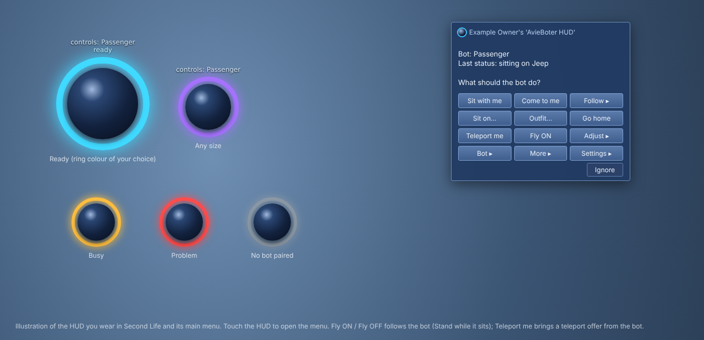


**The app**

| | |
|---|---|
| **First start**  | **Adding a bot**  |
| **Overview** – where the bot is, seats, outfits  | **Chat and IMs**  |
| **Radar** with comings and goings 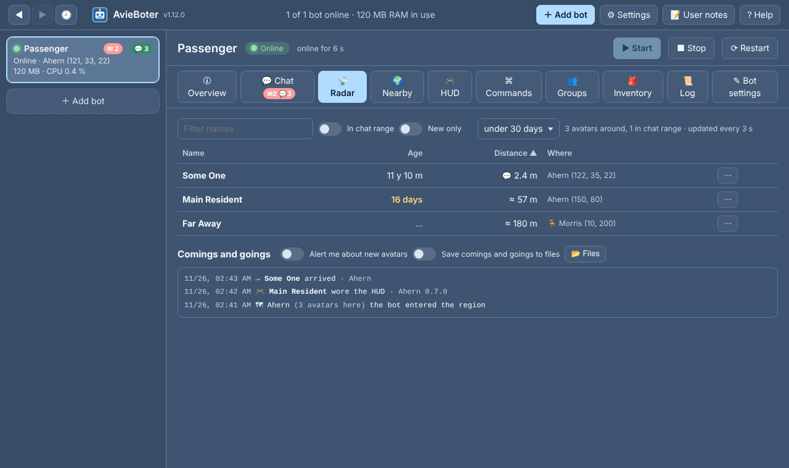 | **Radar menu** on a name  |
| **HUD and people** who use the bot 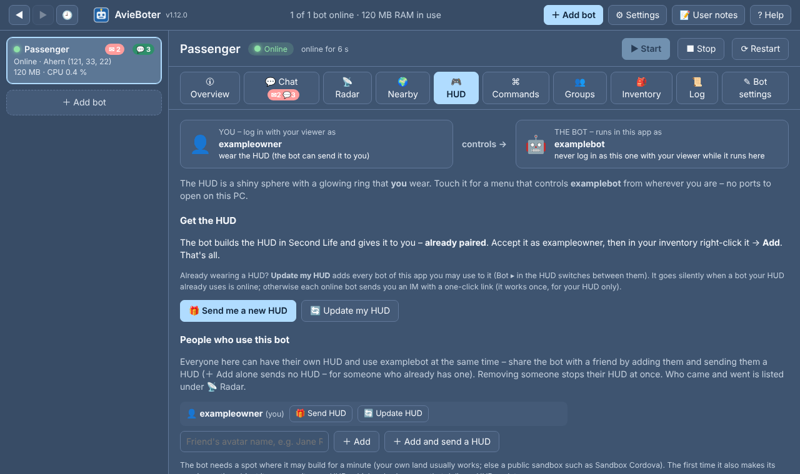 | **Commands** – every SecondBot command with a form  |
| **Groups** – invitations, members and roles 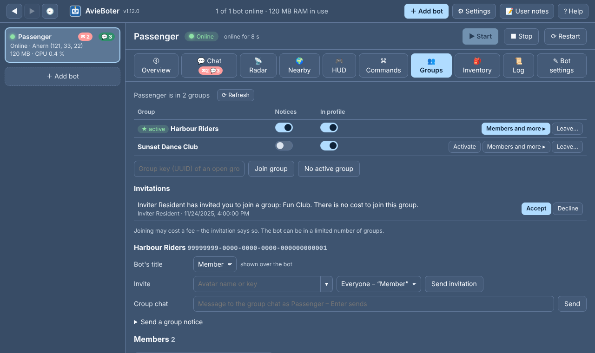 | **Log** of the bot  |
| **Bot settings**  | **Settings** – look, starting and closing  |
| **Settings** – notifications and updates 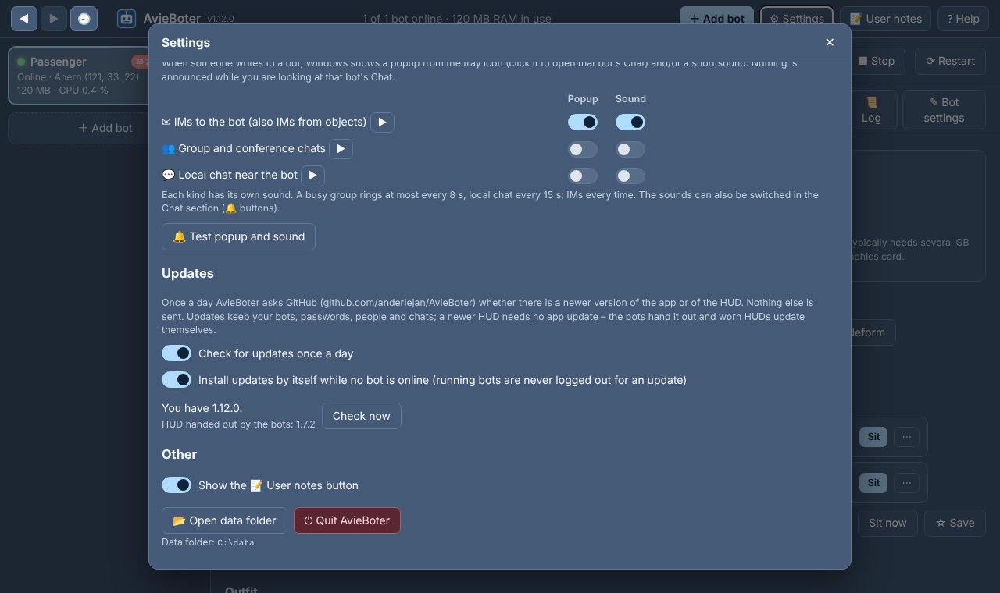 | **An update is ready** 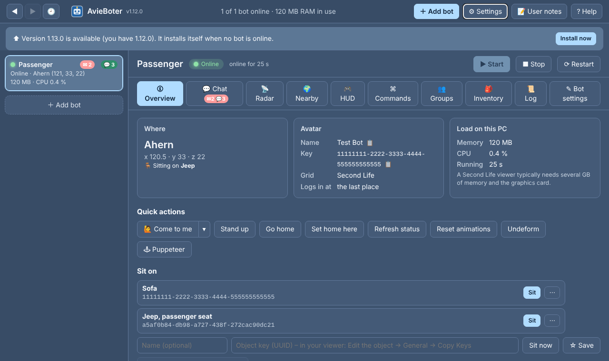 |
| **Back / forward history** 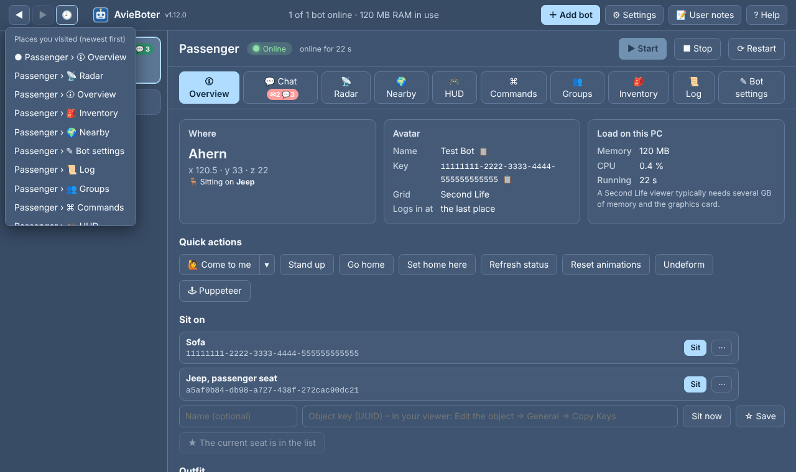 | **Help** 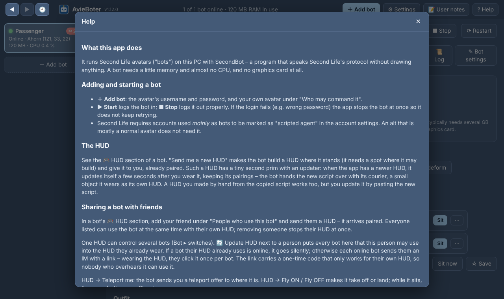 |
| **Nearby** – the objects around the bot 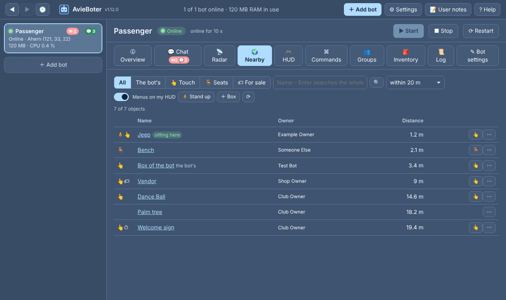 | **Object menus** answered in the app 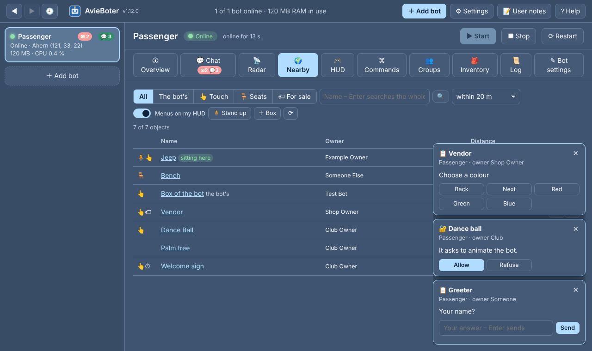 |
| **Contents** of an object the bot may change 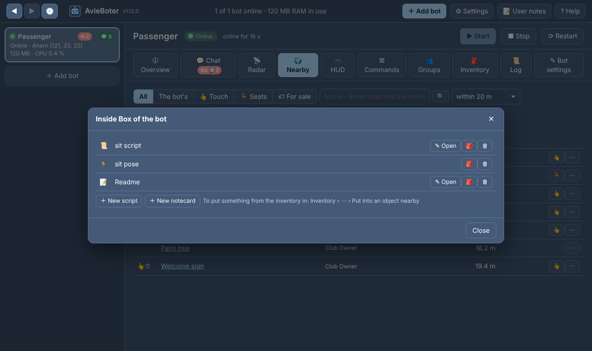 | **Script editor** – save and compile 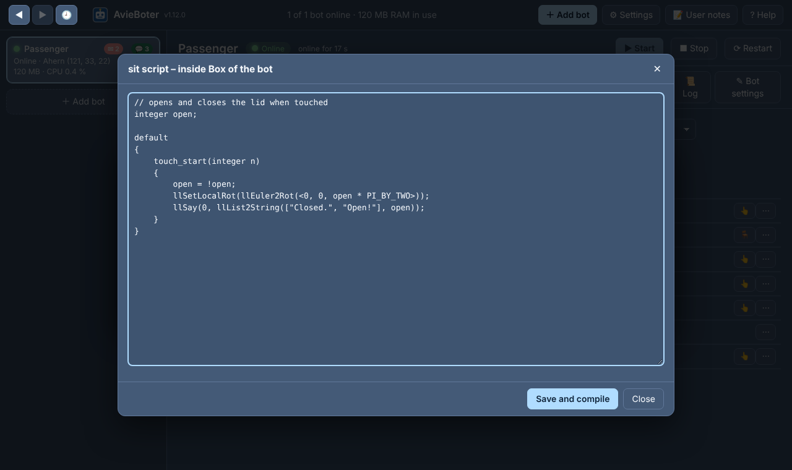 |
| **Inventory** – folders, worn, Trash, search 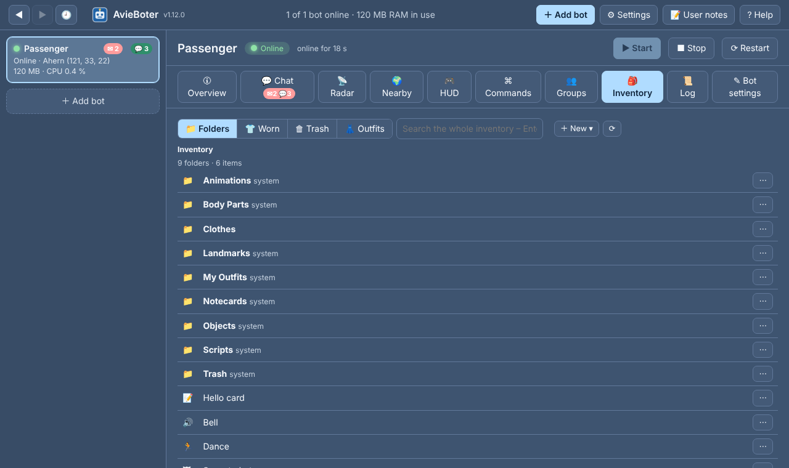 | **Inventory menu** of an object 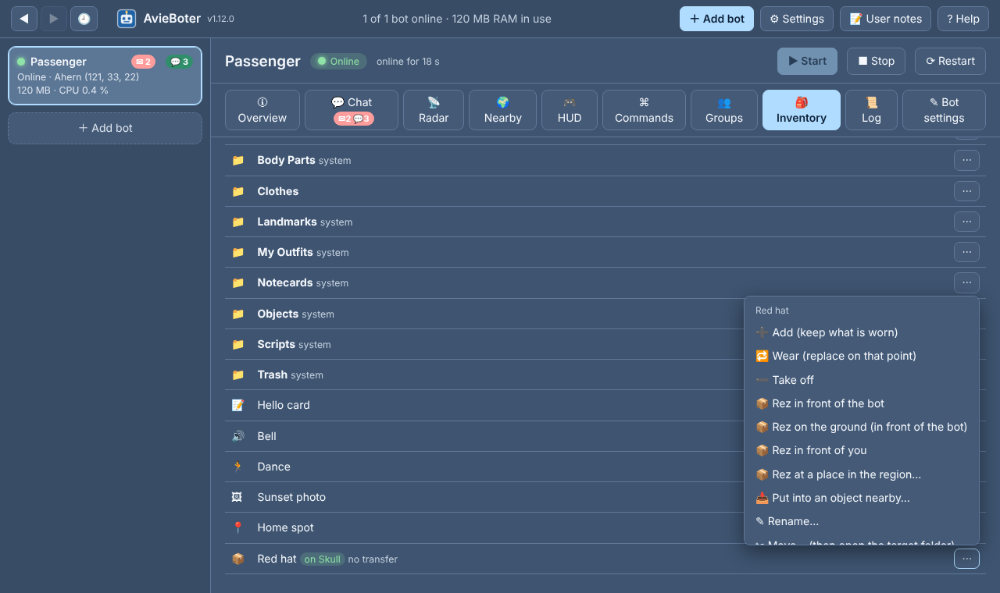 |
| **Outfits** – a gallery with your pictures 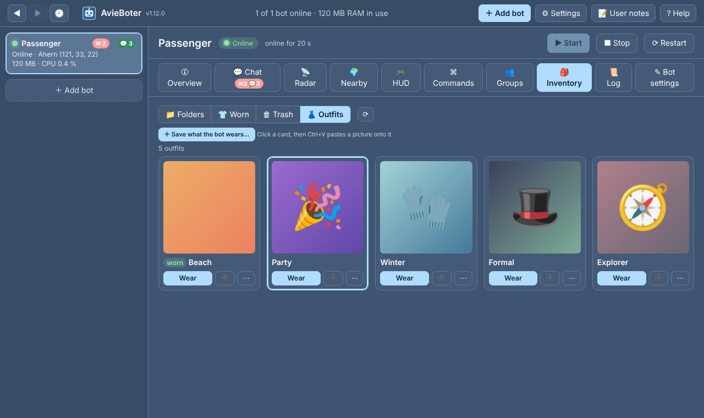 | **User notes** (Settings → Other)  |

## Install
1. Download `AvieBoter-Setup-<version>.exe` from the [latest release](https://github.com/anderlejan/AvieBoter/releases/latest)
   (and, if you like, check it against `SHA256SUMS-<version>.txt`).
2. Run it. It installs for your Windows user only (no administrator rights) and starts AvieBoter.
3. Press **＋ Add bot**: the bot avatar's username and password, and your own avatar under "Who may command it".
4. **▶ Start** logs the bot in. In its 🎮 HUD section, "Send me a new HUD" gives you the HUD in Second Life.

Windows 10 or 11, 64-bit. The installer adds Microsoft Edge WebView2 when it is missing.

**Please note:**
- Follow the Terms of Service and the scripted-agent policy of the grid you use. Second Life asks that accounts
  used mainly as bots are marked as "scripted agent" in the account settings.
- Log in only accounts that are yours, and never log in the same account with a viewer while it runs as a bot.

## Build from source
Needs Windows, the .NET 10 SDK, git, Inno Setup 6 and Python 3 (for the command catalogue check).

```
powershell -NoProfile -ExecutionPolicy Bypass -File build\build.ps1
```

The script fetches SecondBot at the commit in `bot/UPSTREAM_COMMIT`, applies `bot/avieboter.patch`, builds the bot
and the app, runs the tests and makes the installer, a source zip and a checksum list in `..\installers`. It never
overwrites an installer: bump `<Version>` in `manager/AvieBoter.csproj` for every build.

### Layout
- `manager/` – the app: C# .NET 10 WPF host with a WebView2 page (`wwwroot/`), tray icon, bot processes, updater.
  - `Core/BotRunner.cs` – one bot: starts `bot\SecondBotEvents.exe` with its settings as environment variables,
    reads its output, polls `CompanionStatus`, sends signed HTTP commands on 127.0.0.1.
  - `Core/Updater.cs` – looks for the latest GitHub release, downloads the installer, checks its SHA-256 and runs it.
  - `wwwroot/commands.json` – the command catalogue, generated by `build/extract-commands.py` from the patched bot.
- `bot/` – `UPSTREAM_COMMIT` (the pinned SecondBot commit) and `avieboter.patch`: HTTP on 127.0.0.1 only, the
  `Companion` commands for the app and the HUD (status, sitting, coming, following, radar, people, groups, objects
  nearby, object menus, inventory, outfits, notecards and scripts, the camera anchor, building and updating the HUD),
  a chat and IM collector, neighbour regions, and smaller fixes. HUDs 1.4+ get their answers
  as plain text with a short status (their address ends in `/c`), which spares the scripts' memory.
- `hud/` – the HUD's LSL scripts: core, menu and camera (the camera script also shows objects' menus; separate
  scripts because one does not fit LSL's 64 KB) and
  the updater in the HUD's ring prim. Copies ship in `manager/wwwroot/hud/`; the build checks they are equal.
- `installer/AvieBoter.iss` – Inno Setup 6, per-user install.
- `tests/` – `signtest` (command signing against SecondBot's own validation), `coretest` (storage), `ui_smoke.py` +
  `mock.js` (the page in headless Chrome with a fake host), `make_screenshots.py` (the pictures above).

### Data
Everything AvieBoter keeps is in `%LOCALAPPDATA%\AvieBoter`: settings, the bot list with encrypted passwords, chats,
logs, the outfit pictures (`bots\<bot>\outfits\`), and per bot – only when "Save comings and goings to files" is switched on in its Radar (off by default) –
`events\events-YYYY-MM-DD.jsonl` (one JSON object per line: `t` (Unix ms), `type` (arrive, leave,
hud, hud-off, hud-check, use, refused, follow, follow-lost, region, young, group-invite), `uuid`, `name`, `region`, `extra`, `bot`). Updates and
uninstalling leave it alone.

## Licence and credits
AvieBoter is free software under the [GNU General Public License v3.0](LICENSE) or later.

It is built on [SecondBot](https://github.com/Madpeterz/SecondBot) by Madpeterz (GPL-3.0), which includes
[LibreMetaverse](https://github.com/cinderblocks/libremetaverse) (BSD 3-Clause). This repository holds only
AvieBoter's own code and its patch to SecondBot; the build fetches SecondBot from its repository. See
[THIRD-PARTY-NOTICES.md](THIRD-PARTY-NOTICES.md) for all components and their licences.

Second Life is a trademark of Linden Research, Inc. AvieBoter is not affiliated with or endorsed by Linden Lab.
OpenSimulator is a project of its own contributors; AvieBoter is not part of it.
