# AvieBoter

> **Experimental software.** AvieBoter is provided "as is", without any warranty. Use it at your own risk and not
> for anything serious.

AvieBoter is a Windows tray app that runs Second Life avatars ("bots") on your PC – without a viewer and without a
graphics card – and lets you control them from the app and from a HUD you wear in Second Life. Its first use: a
passenger bot that sits in your vehicle and travels with you.

It runs the bots with a patched [SecondBot](https://github.com/Madpeterz/SecondBot). A bot needs far less memory than
a viewer and almost no CPU.

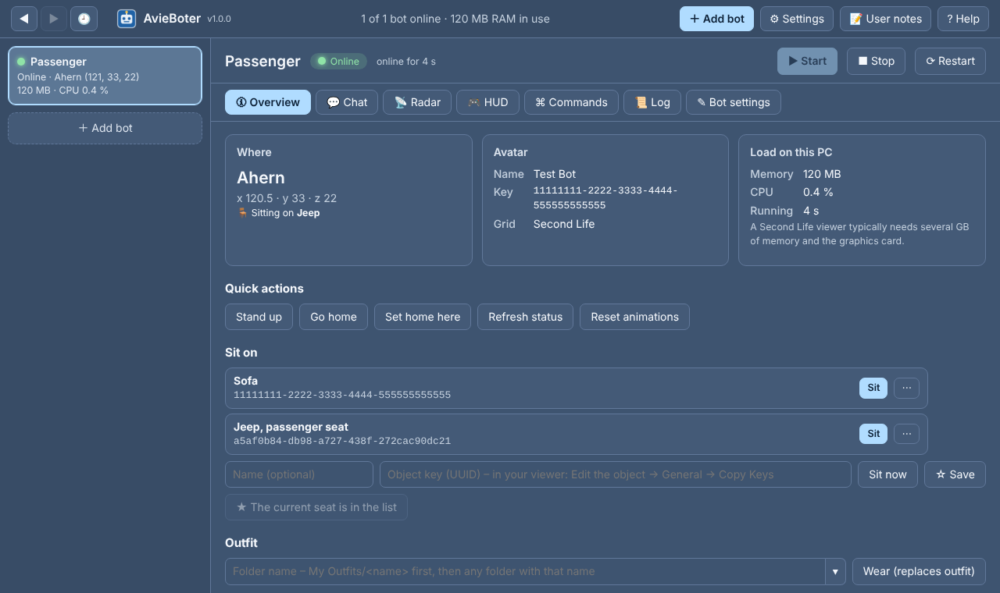

## What it can do
- **Bots in the tray:** add bot avatars, start and stop them, see where they are, what they sit on and what they use
  on this PC. Passwords are stored encrypted for your Windows user (DPAPI) and passed only to the bot process.
- **A HUD in Second Life:** the bot builds a HUD, gives it to you already paired, and keeps it up to date. From its
  menu the bot comes to you, sits with you on a vehicle, follows you, sits on saved seats, goes home and more – from
  anywhere, with no ports opened on your PC.
- **Sharing:** friends you add to a bot get their own HUD and can use the bot at the same time.
- **Chat and IMs** of the bot in the app, with Windows popups and sounds.
- **Radar** of the avatars around the bot, with arrivals and departures saved to daily files for other tools.
- **Commands:** everything SecondBot can do, with a form for each command.
- **Updates:** once a day AvieBoter looks for a newer release here and installs it by itself while no bot is
  online (it checks the file's SHA-256 first). Your bots and settings stay. Settings → Updates switches it off.

## Screenshots
**The HUD in Second Life** (illustration drawn from the HUD's script; names are fictional)


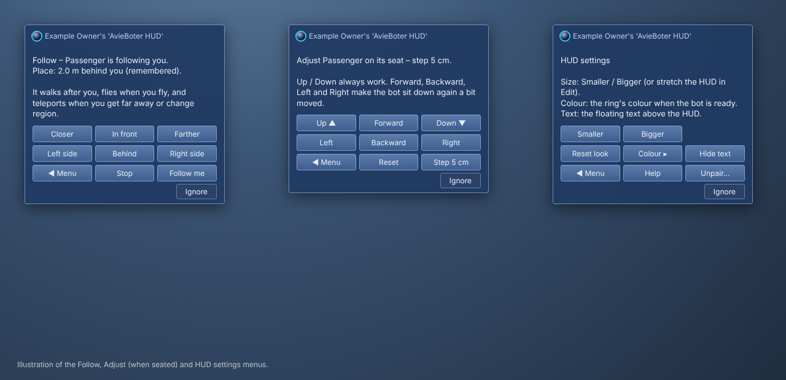

**The app**

| | |
|---|---|
| **First start** 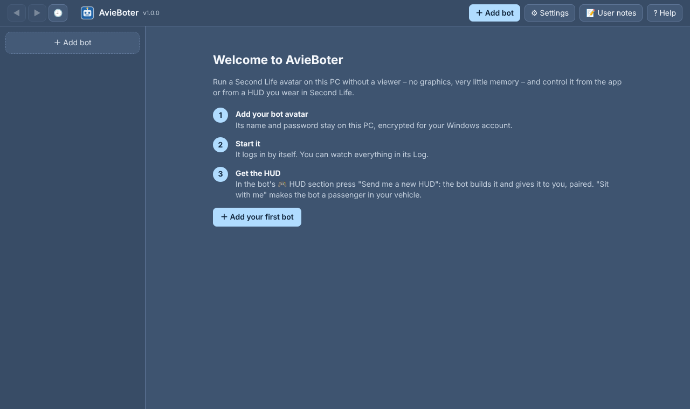 | **Adding a bot** 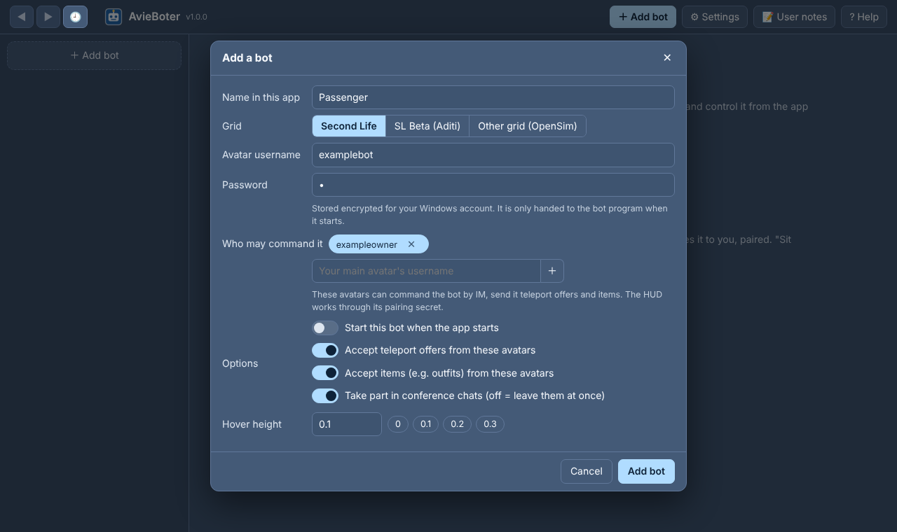 |
| **Overview** – where the bot is, seats, outfits  | **Chat and IMs** 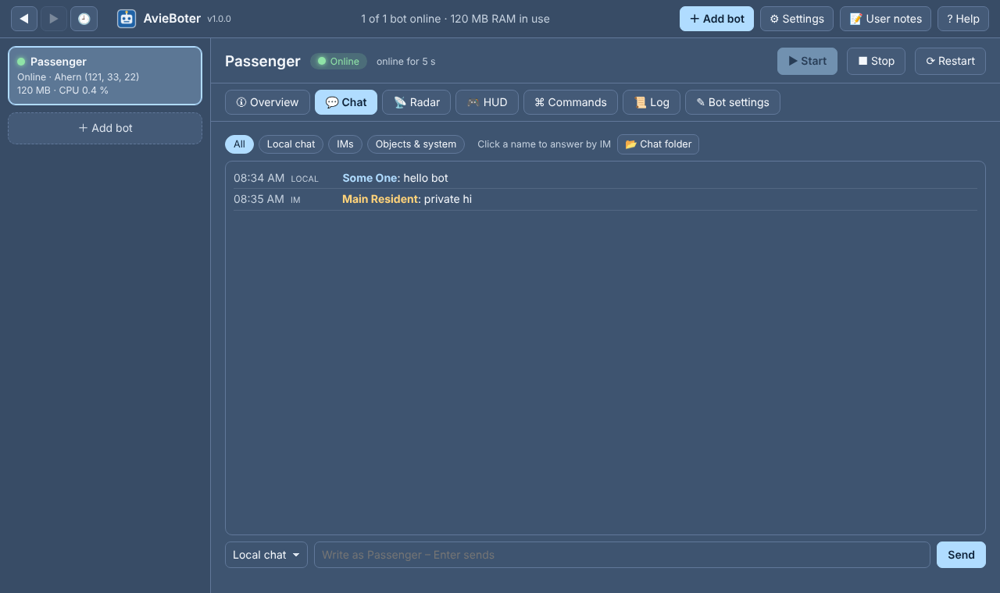 |
| **Radar** with comings and goings  | **Radar menu** on a name 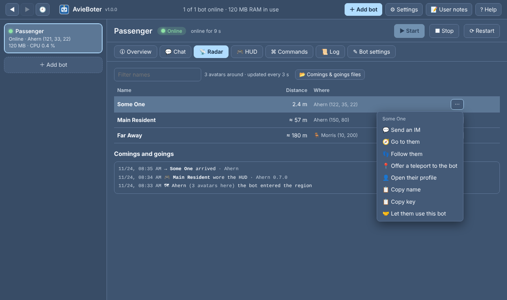 |
| **HUD and people** who use the bot  | **Commands** – every SecondBot command with a form 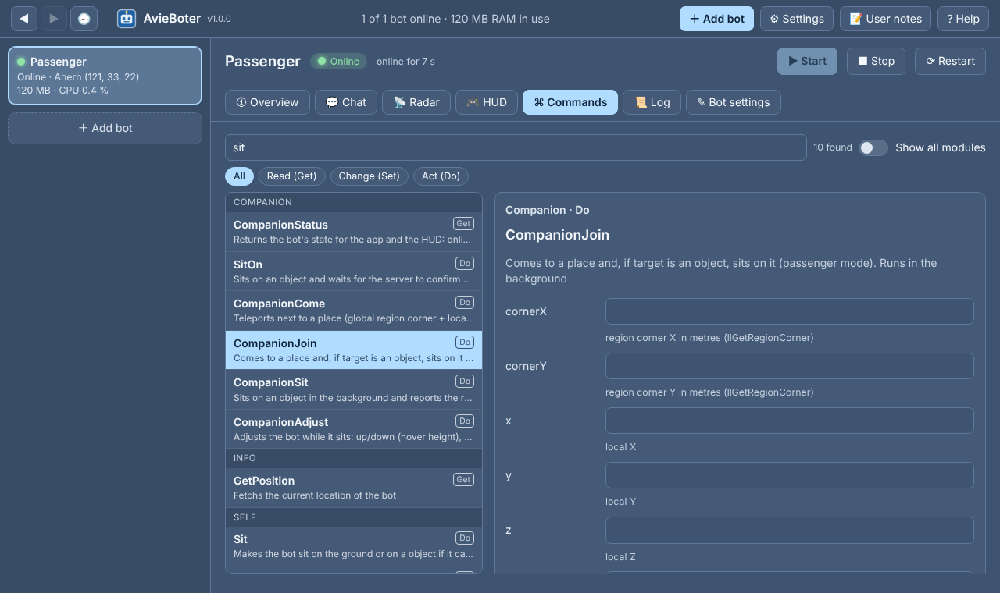 |
| **Log** of the bot 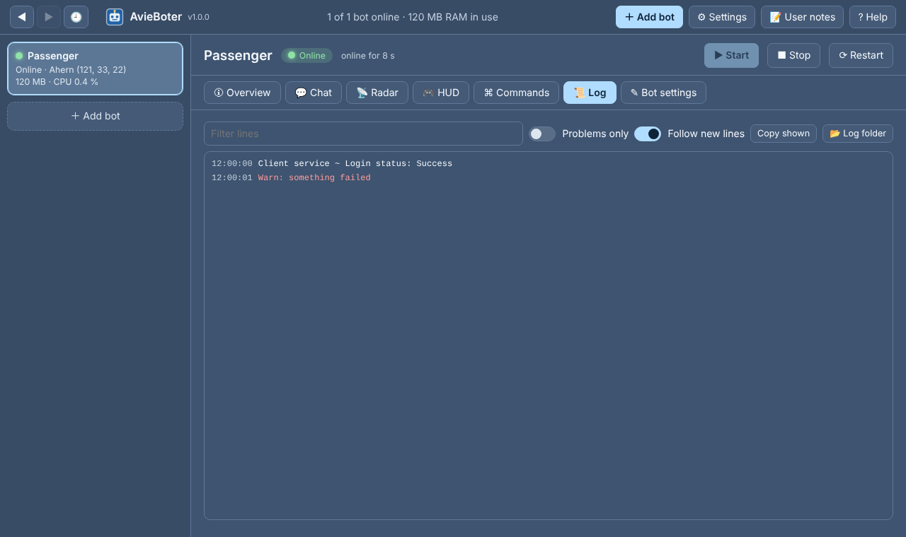 | **Bot settings** 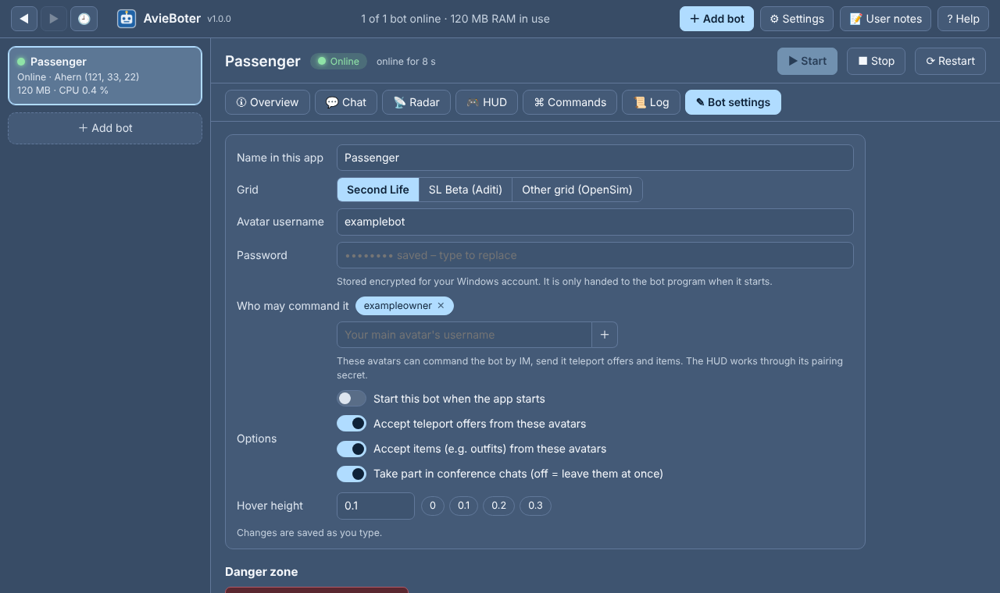 |
| **Settings** – look, starting and closing 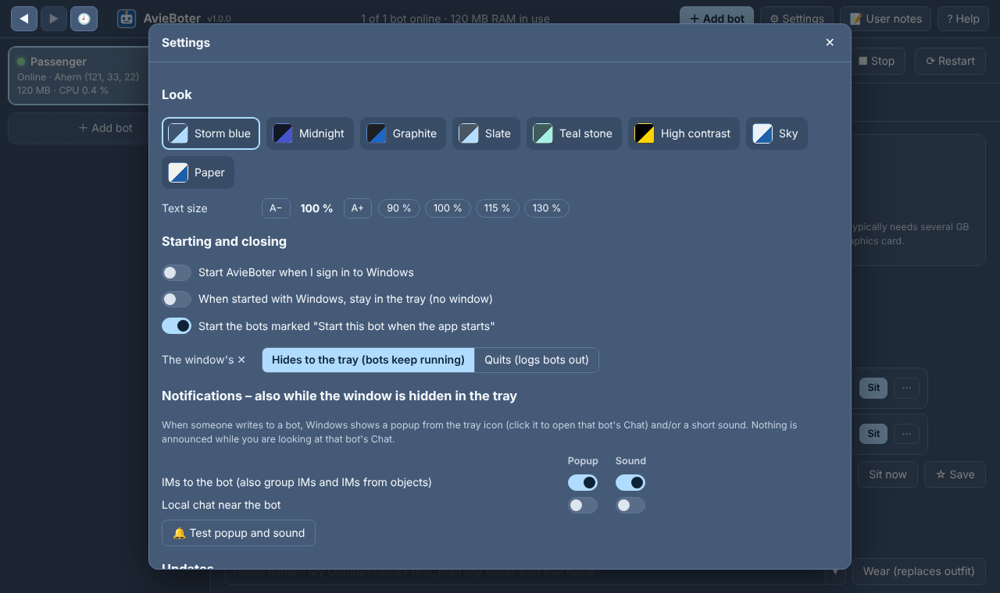 | **Settings** – notifications and updates  |
| **An update is ready**  | **Back / forward history**  |
| **Help**  | **User notes** (Settings → Other) 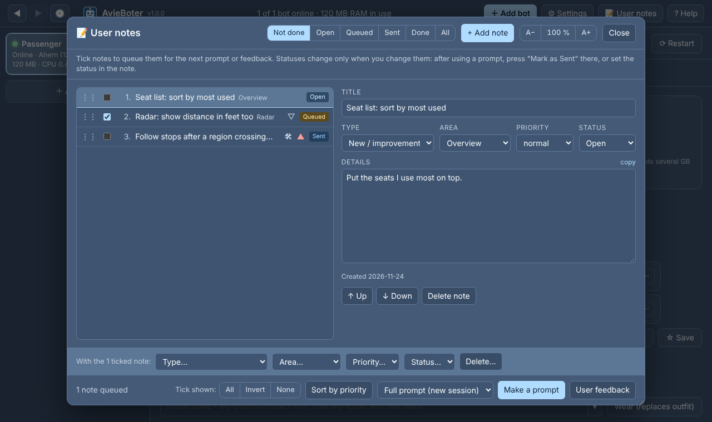 |

## Install
1. Download `AvieBoter-Setup-<version>.exe` from the [latest release](https://github.com/anderlejan/AvieBoter/releases/latest)
   (and, if you like, check it against `SHA256SUMS-<version>.txt`).
2. Run it. It installs for your Windows user only (no administrator rights) and starts AvieBoter.
3. Press **＋ Add bot**: the bot avatar's username and password, and your own avatar under "Who may command it".
4. **▶ Start** logs the bot in. In its 🎮 HUD section, "Send me a new HUD" gives you the HUD in Second Life.

Windows 10 or 11, 64-bit. The installer adds Microsoft Edge WebView2 when it is missing.

**Please note:**
- Follow the Terms of Service and the scripted-agent policy of the grid you use. Second Life asks that accounts
  used mainly as bots are marked as "scripted agent" in the account settings.
- Log in only accounts that are yours, and never log in the same account with a viewer while it runs as a bot.

## Build from source
Needs Windows, the .NET 10 SDK, git, Inno Setup 6 and Python 3 (for the command catalogue check).

```
powershell -NoProfile -ExecutionPolicy Bypass -File build\build.ps1
```

The script fetches SecondBot at the commit in `bot/UPSTREAM_COMMIT`, applies `bot/avieboter.patch`, builds the bot
and the app, runs the tests and makes the installer, a source zip and a checksum list in `..\installers`. It never
overwrites an installer: bump `<Version>` in `manager/AvieBoter.csproj` for every build.

### Layout
- `manager/` – the app: C# .NET 10 WPF host with a WebView2 page (`wwwroot/`), tray icon, bot processes, updater.
  - `Core/BotRunner.cs` – one bot: starts `bot\SecondBotEvents.exe` with its settings as environment variables,
    reads its output, polls `CompanionStatus`, sends signed HTTP commands on 127.0.0.1.
  - `Core/Updater.cs` – looks for the latest GitHub release, downloads the installer, checks its SHA-256 and runs it.
  - `wwwroot/commands.json` – the command catalogue, generated by `build/extract-commands.py` from the patched bot.
- `bot/` – `UPSTREAM_COMMIT` (the pinned SecondBot commit) and `avieboter.patch`: HTTP on 127.0.0.1 only, the
  `Companion` commands for the app and the HUD (status, sitting, coming, following, radar, people, building and
  updating the HUD), a chat and IM collector, neighbour regions, and smaller fixes.
- `hud/` – the HUD's LSL scripts: core, menu (two scripts because one does not fit LSL's 64 KB) and the updater in
  the HUD's ring prim. Copies ship in `manager/wwwroot/hud/`; the build checks they are equal.
- `installer/AvieBoter.iss` – Inno Setup 6, per-user install.
- `tests/` – `signtest` (command signing against SecondBot's own validation), `coretest` (storage), `ui_smoke.py` +
  `mock.js` (the page in headless Chrome with a fake host), `make_screenshots.py` (the pictures above).

### Data
Everything AvieBoter keeps is in `%LOCALAPPDATA%\AvieBoter`: settings, the bot list with encrypted passwords, chats,
logs, and per bot `events\events-YYYY-MM-DD.jsonl` (one JSON object per line: `t` (Unix ms), `type` (arrive, leave,
hud, hud-off, use, refused, follow, follow-lost, region), `uuid`, `name`, `region`, `extra`, `bot`). Updates and
uninstalling leave it alone.

## Licence and credits
AvieBoter is free software under the [GNU General Public License v3.0](LICENSE) or later.

It is built on [SecondBot](https://github.com/Madpeterz/SecondBot) by Madpeterz (GPL-3.0), which includes
[LibreMetaverse](https://github.com/cinderblocks/libremetaverse) (BSD 3-Clause). This repository holds only
AvieBoter's own code and its patch to SecondBot; the build fetches SecondBot from its repository. See
[THIRD-PARTY-NOTICES.md](THIRD-PARTY-NOTICES.md) for all components and their licences.

Second Life is a trademark of Linden Research, Inc. AvieBoter is not affiliated with or endorsed by Linden Lab.
OpenSimulator is a project of its own contributors; AvieBoter is not part of it.
